<div align="center">

# 🌍 GROUND X

### Every world has a twin on Earth.

**A bilingual (English / العربية) interactive atlas that pairs landing sites on the Moon and Mars with geologically similar places on Earth.** It compares each pair criterion by criterion using real elevation data, and shows the rovers suited to that ground.

[**🚀 Open the live site**](https://hamzasaif533.github.io/groundx/) · [العربية](https://hamzasaif533.github.io/groundx/?lang=ar) · [Light mode](https://hamzasaif533.github.io/groundx/?theme=light)


<br>

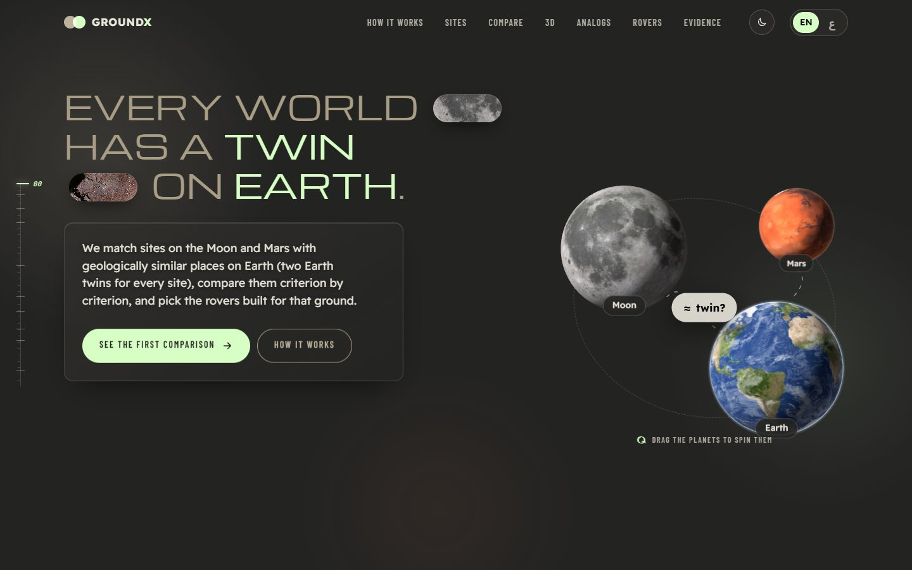

</div>

---

## ✨ What it does

Space agencies test rovers, spacesuits and procedures in places on Earth that behave like the Moon or Mars. These are called **planetary analogs**. Ground X makes that idea visible:

1. **Pick a site** on the Moon or Mars.
2. **Meet its Earth twins.** Each site has two analog slots, anywhere in the world.
3. **Compare them criterion by criterion:** terrain, slope, roughness, elevation, geology, rock size and density, and temperature, each with its values, method, status and evidence map.
4. **Explore the real terrain in 3D** and walk along the elevation profile.
5. **Match the rovers** built for that ground (vehicle research in progress).

> **Data honesty is a core rule.** Every number is copied from the research team's files and is never recalculated. Anything not yet measured shows **"Pending"**. No similarity percentage is published until a documented scoring method exists.

---

## 🛰️ Sites in the atlas

| | Site | Earth twin(s) | Data on the site |
|:-:|---|---|---|
| 🌕 | **Shackleton Rim**, lunar south pole | **Haughton Crater**, Devon Island, Canada | NASA Site04 DEM (5 m/px), slope + roughness rasters, elevation profile, 3D terrain |
| 🔴 | **Syrtis Major** | **Samail Ophiolite**, Al Hajar Mountains, Oman | Slope, roughness and elevation statistics for Samail |
| 🔴 | **Valles Marineris** | Wadi Ghul, Oman | Pairing + Mars Trek imagery |
| 🔴 | **Aonia Terra** | Al Sharqiya Sands, Oman | Pairing + Mars Trek imagery |
| 🔴 | **Jezero Crater** | Wadi Mistal & the Huqf area, Oman | Pairing + Mars Trek imagery |
| 🧪 | | **AMADEE-18 "Kepler" station**, Dhofar, Oman (2018 Mars analog mission site) | Slope, roughness and elevation statistics |

---

## 🖼️ A tour of the site

<table>
<tr>
<td width="50%">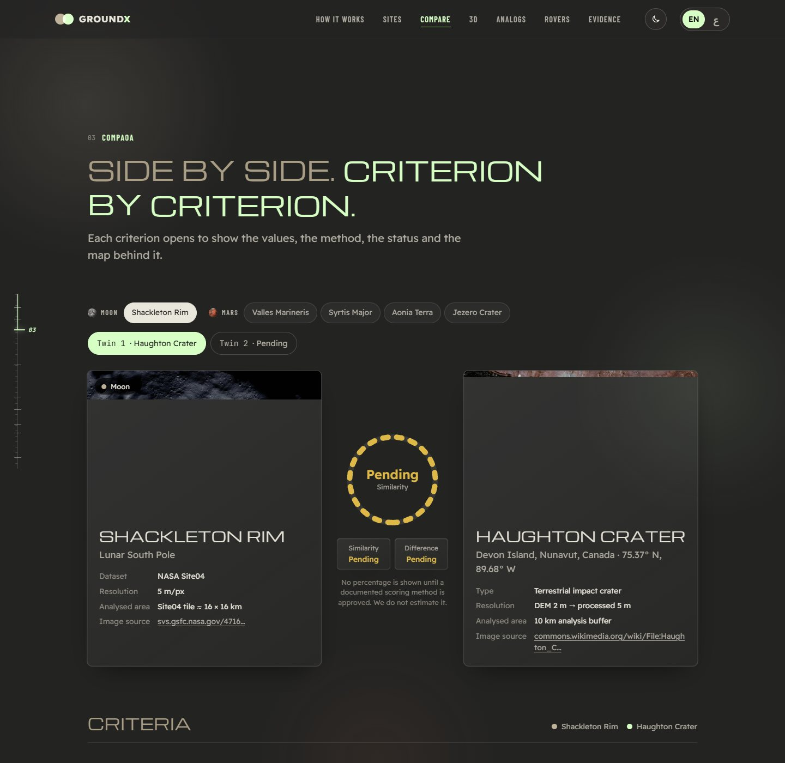</td>
<td width="50%">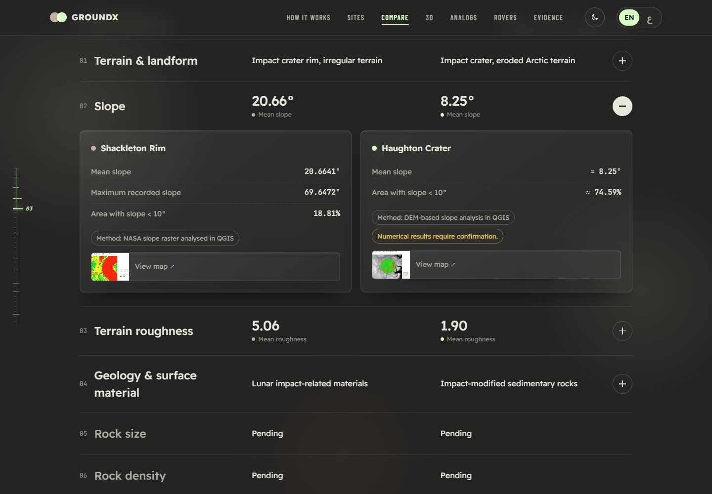</td>
</tr>
<tr>
<td><b>Side by side.</b> Pick any site and twin. The similarity score stays <i>Pending</i> until it can be computed properly.</td>
<td><b>Criterion by criterion.</b> Open a row to see the values, the method, the team's status note and the map behind it.</td>
</tr>
<tr>
<td>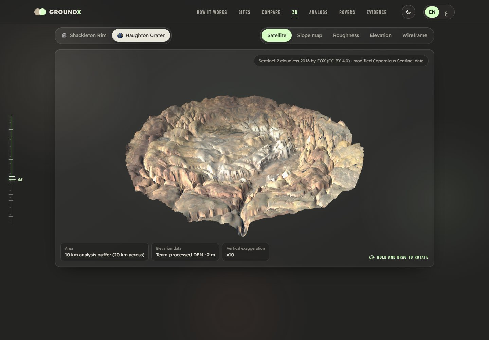</td>
<td>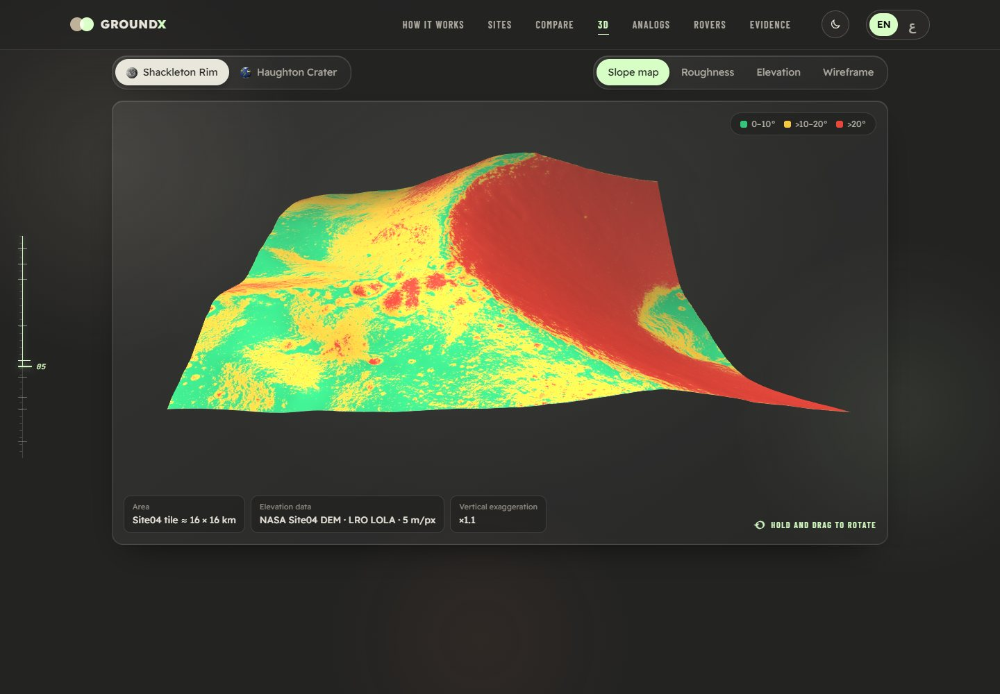</td>
</tr>
<tr>
<td><b>Explore in 3D.</b> Real elevation models you can hold and spin. Haughton shows Sentinel-2 satellite imagery reprojected onto the DEM grid.</td>
<td><b>Switch layers:</b> Satellite · Slope map · Roughness · Elevation · Wireframe. Each one is the team's own aligned raster.</td>
</tr>
<tr>
<td>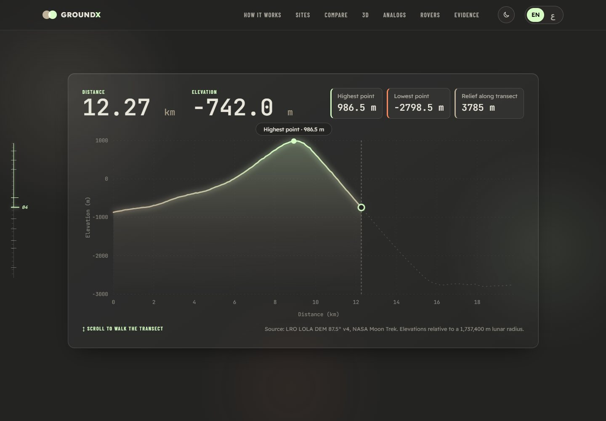</td>
<td>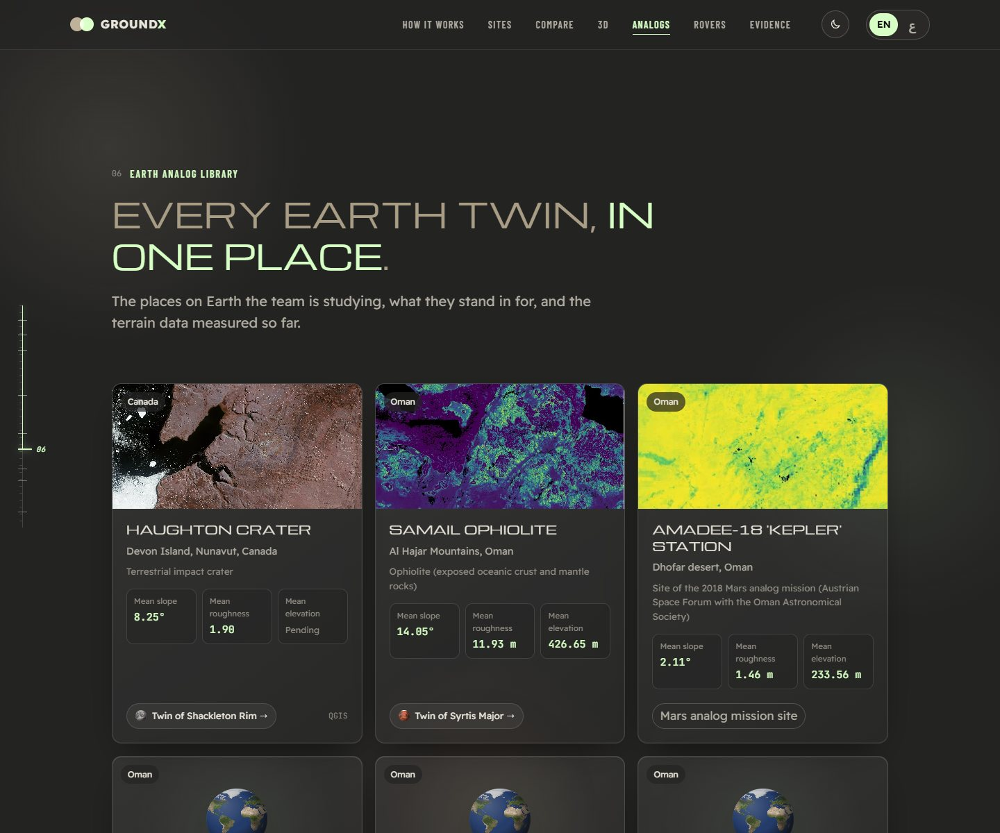</td>
</tr>
<tr>
<td><b>Walk down into Shackleton.</b> Scroll and a probe travels along a real 19.8 km LRO LOLA transect, showing distance and elevation live.</td>
<td><b>Earth analog library.</b> Every Earth twin in one place, with what it stands in for and its measured terrain values.</td>
</tr>
<tr>
<td>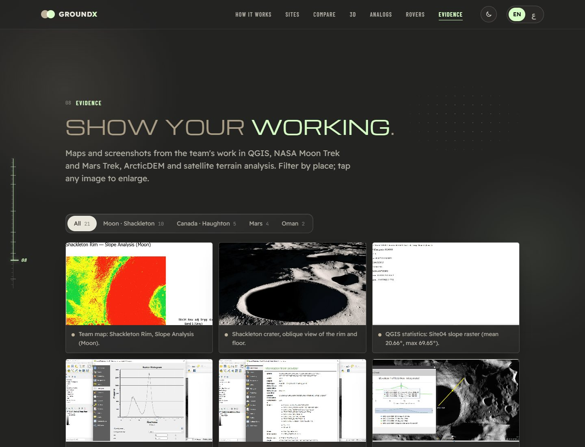</td>
<td>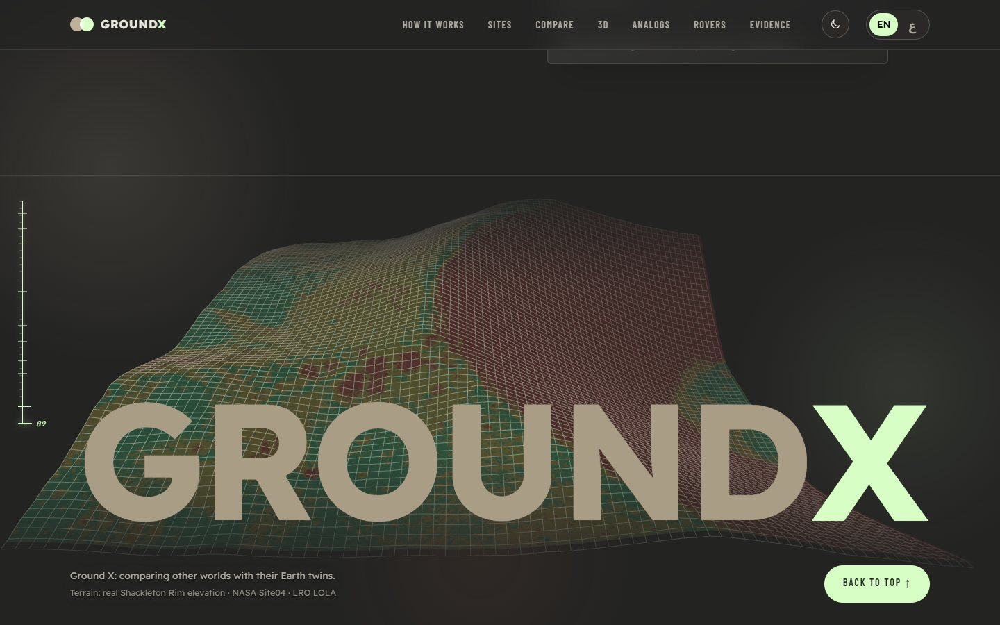</td>
</tr>
<tr>
<td><b>Show your working.</b> QGIS maps, NASA Moon Trek and Mars Trek views, ArcticDEM checks, filterable by place.</td>
<td><b>The footer terrain</b> cycles through wireframe, slope, roughness and elevation on the real Shackleton grid.</td>
</tr>
</table>

---

## 🌗 Two languages, two themes, any screen

<table>
<tr>
<td width="50%">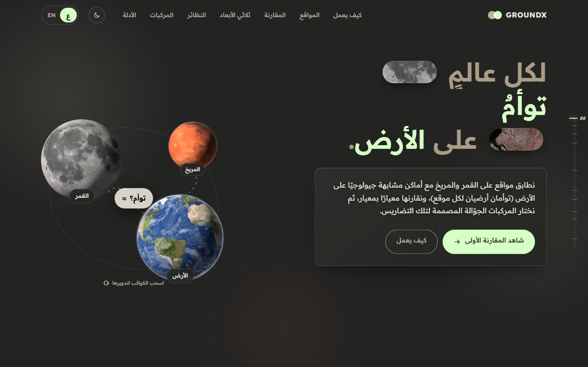</td>
<td width="50%">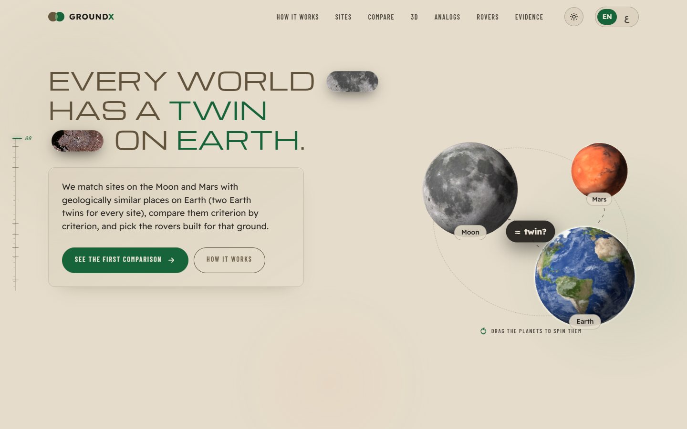</td>
</tr>
<tr>
<td align="center"><b>Full Arabic, right to left.</b> Every string exists in both languages; Western digits throughout.</td>
<td align="center"><b>Light mode</b> in warm paper tones, with a circular reveal when you switch.</td>
</tr>
</table>

<p align="center">
  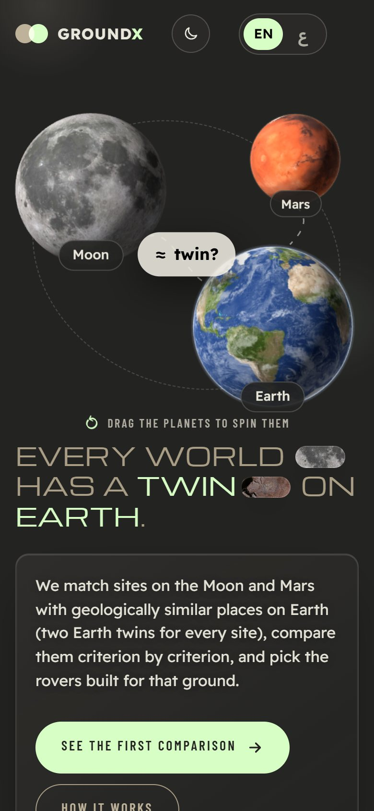
  &nbsp;&nbsp;&nbsp;
  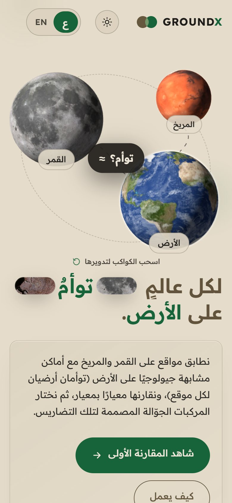
</p>

---

## 🧭 How a comparison is built

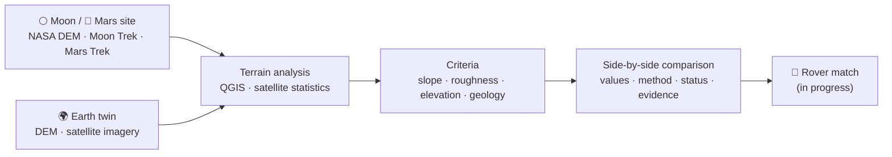

---

## 🎛️ Interaction highlights

- **3D planets.** The Moon shows its near side, Mars the Valles Marineris and Tharsis region, and Earth the Atlantic. Drag any planet to spin it.
- **3D terrain explorer:** hold and drag to rotate and tilt, with five draped layers and a labelled vertical exaggeration.
- **Scroll-driven elevation profile** that pins on desktop while a probe walks the transect.
- **Side rail:** a quiet measuring-scale progress bar; click anywhere to glide to that point.
- **GSAP motion throughout:** split-text headlines, image reveals, a magnetic footer wordmark, sliding selectors and an infinite marquee. All of it respects *prefers-reduced-motion*.
- **Shareable deep links:** `?lang=ar`, `?theme=light`, `?at=compare` (jump to any section id).

---

## 🗂️ Project structure

```
index.html                 page shell (sections, nav, ruler, lightbox)
assets/
  css/style.css            design system, dark + light themes, RTL via logical properties
  js/data.js               ★ all research content: sites, twins, criteria, evidence, sources
  js/i18n.js               interface text in English and Arabic
  js/app.js                rendering, language/theme switching, GSAP animation
  js/terrain.js            Three.js terrain engine (wireframe + draped layers)
  js/globes.js             Three.js Moon, Mars and Earth in the hero
  data/terrain.js          Shackleton Site04 elevation grid (160 × 158)
  data/haughton-dem.js     Haughton elevation grid (160 × 160)
  data/profile.js          Shackleton elevation transect (LRO LOLA)
  img/                     web-ready maps, photos, team screenshots, planet textures
docs/screenshots/          images used in this README
```

---

## 🚀 Run it locally

No build step and no dependencies. It's plain HTML, CSS and JS; GSAP and Three.js load from a CDN.

```bash
git clone https://github.com/Hamzasaif533/groundx.git
cd groundx
python -m http.server 5173
```

Then open **http://localhost:5173**. Serve the folder rather than double-clicking `index.html`, because browsers block WebGL textures on `file://` pages. Opened as a file, the 3D globes fall back to flat versions.

---

## ✏️ Adding research as it arrives

Everything lives in **`assets/js/data.js`**, written in both languages as `{ en, ar }`:

| To add… | Do this |
|---|---|
| A Moon or Mars site | Push an object into `GX.SITES` (copy a `marsSite({...})` entry). It appears in the tabs, the site switcher and the counts automatically. |
| A second Earth twin | Replace the `null` in that site's `analogs: [ … , null ]`. |
| Terrain statistics | Put raw values in `GX.GEE_STATS`; `geeCriteria()` turns them into slope, roughness and elevation criteria. |
| An Earth analog card | Add to `GX.ANALOG_LIBRARY`. |
| Evidence images | Add to `GX.EVIDENCE` with a `group` (`moon`, `canada`, `mars`, `oman`). |
| A similarity % | Set `comparison.similarity`, **only** once a documented scoring method exists. |
| A rover | Fill `GX.ROVERS["pending-1"]` or add a new rover and list its id in `analog.rovers`. |

After editing a CSS or JS file, increase the `?v=` number on its link in `index.html` so browsers load the new version.

---

## 📚 Data & credits

| Source | Used for |
|---|---|
| [NASA PGDA, Site04](https://pgda.gsfc.nasa.gov/products/78) · LRO LOLA | Shackleton elevation, slope and roughness |
| [NASA SVS](https://svs.gsfc.nasa.gov/4716) | Shackleton imagery |
| [NASA Mars Trek](https://trek.nasa.gov/mars/) | Team views of the Mars sites |
| [NASA/JPL Photojournal](https://science.nasa.gov/photojournal/) · PIA00422, PIA23239, PIA20984, PIA13839 | Valles Marineris, Jezero, Syrtis Major and Aonia Terra photos |
| [NASA Earth Observatory](https://science.nasa.gov/earth/earth-observatory/earths-crust-exposed-in-oman-77569) (EO-1 ALI, 2012) | Samail Ophiolite photo |
| [NASA JSC astronaut photography](https://eol.jsc.nasa.gov/) · STS085-501-14, ISS053-E-302321 | Al Sharqiya Sands and Al Hajar Mountains photos |
| [NASA Ames, K-10 rover at Haughton](https://images.nasa.gov/details/ARC-2007-ACD07-0170-001) (2007) | Rover field-test evidence |
| [Landsat 8 (Wikimedia Commons)](https://commons.wikimedia.org/wiki/File:Haughton_Crater_-Landsat_8(48010457521).png) | Haughton photo |
| [ArcticDEM mosaic v4.1, 2 m](https://www.pgc.umn.edu/data/arcticdem/) (Polar Geospatial Center) | Haughton elevation model and site checks |
| [Sentinel-2 cloudless 2016 by EOX](https://s2maps.eu) (CC BY 4.0, modified Copernicus Sentinel data) | Haughton 3D satellite layer |
| [Solar System Scope](https://www.solarsystemscope.com/textures/) (CC BY 4.0) | 3D planet textures |
| Gawronska et al. (2020), *Advances in Space Research* 66 | Lunar south pole geology |
| Leask et al. (2021), *Earth and Space Science* 8 | Samail Ophiolite as a Mars analog |
| [Austrian Space Forum, AMADEE-18](https://oewf.org/en/amadee-18/) · EPSC 2018 abstracts | Dhofar Mars analog mission |

Built with [GSAP](https://gsap.com/) and [Three.js](https://threejs.org/). Typography: Michroma, Readex Pro, Barlow Condensed, JetBrains Mono (Google Fonts).

<div align="center">
<br>

**GROUND X** · comparing other worlds with their Earth twins

</div>
